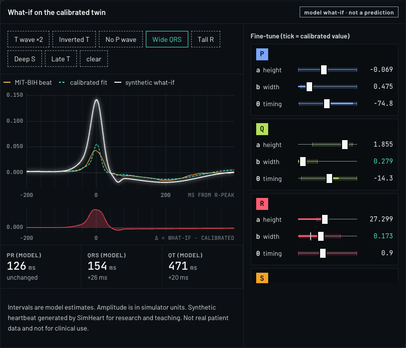
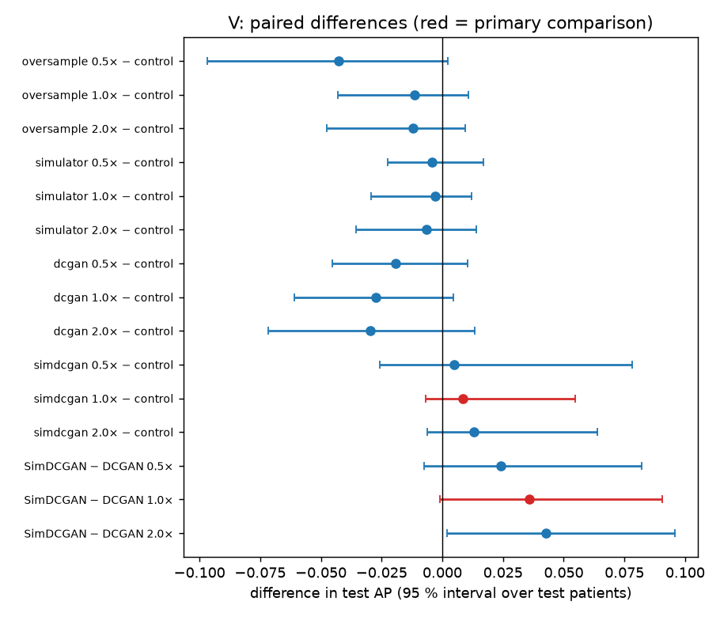

# SimHeart Technical Report

## 1. Introduction

The MIT-BIH Arrhythmia Database contains far fewer examples of some heartbeat classes than others. SimHeart uses this dataset to study two approaches to creating ECG waveforms. The first fits the ECGSYN simulator to an existing beat and changes its parameters. The second uses trained DCGAN and physics-informed SimDCGAN generators to draw new supraventricular ectopic (S), ventricular ectopic (V) and fusion (F) beats.

The project asks whether the application can perform both workflows and how the generated beats compare with real examples. A separate classifier experiment evaluates whether adding generated examples affects detection on the DS2 test split. The report presents the live application measurements and the recorded classifier outcomes in separate subsections.

## 2. Methods

The project uses MIT-BIH lead MLII sampled at 360 Hz. Each 216-sample window starts 200 ms before the annotated R peak. The DS1 records are split into 19 training and three validation records (118, 205 and 223). DS2 supplies 22 test records. Records 201 and 202 share a participant across training and test, so the results package also reports the sensitivity analysis excluding record 202. The project drops the Q group and excludes paced records from the split. [PhysioNet MIT-BIH database](https://physionet.org/content/mitdb/1.0.0/), [de Chazal et al., Table I and split description](https://citeseerx.ist.psu.edu/document?doi=1b6daa11728616118be91a3369c1c6ca3147115b&repid=rep1&type=pdf).

ECGSYN models each P, Q, R, S and T wave with an amplitude, width and angular position. The median training fit R² was 0.982 for S, 0.986 for V and 0.983 for F. The fit rejected 30 of 4,389 beats at R² below 0.8. A class-specific DCGAN learns from real beat windows. SimDCGAN adds an Euler residual loss to the same adversarial setup. The experiment uses fitted parameter sets with small jitter because this keeps dependencies between parameters. Scaling, the simulator time step, fitted parameter constraints, the generator layout and the Euler weight differ from the paper's text in ways documented in the experiment results. [Golany et al., SimGANs](https://proceedings.mlr.press/v119/golany20a.html).

A one-vs-rest classifier was trained on real data and evaluated with real-only, repeated-real, simulator, DCGAN and SimDCGAN setups. Augmentation added 0.5×, 1× or 2× as many examples as the target class had in training. The main comparison uses average precision (AP) on DS2. The results also cover precision at fixed recall, F1, train on synthetic and test on real, distribution distance, diversity, Euler residual, high-frequency energy and nearest-training-beat distance.

### 2.1 Application workflows

| Workflow | Input | Output |
|---|---|---|
| Calibrate and simulate | A bundled MIT-BIH validation beat or a single-lead CSV with 216 amplitude samples at 360 Hz, aligned to the R peak at sample index 72 | A fitted ECGSYN waveform and a synthetic waveform computed after changing a fitted parameter |
| GAN generation | A selected class (S, V or F), a trained checkpoint and a random seed | New class-specific samples from DCGAN and SimDCGAN, displayed alongside real validation beats |

### 2.2 Deviations from SimGANs and reproducibility

| Area | SimHeart implementation |
|---|---|
| ECG scaling and integration | Beats are scaled to the authors’ intended simulator range of −0.01563 to 0.042557. The integration step is 1/216 of a cycle. Wave angles wrap across ±180°, and the baseline wander amplitude is 0.005 in simulator units. |
| Parameter fitting and sampling | The fitter keeps widths positive and wave positions ordered. It uses five starting points and excludes the last 50 ms of S windows from the training fit. The parameter sampler draws fitted vectors with 2% jitter. The handoff reports that 89–91% of those samples passed its waveform plausibility checks, compared with 6–17% for independent Gaussian draws. Those percentages describe the project’s checks. |
| GAN architecture and loss | The generator has seven transposed convolution layers. Training uses Adam at 0.0002 and two generator updates per discriminator update. The Euler loss weight is 0.0047. In the documented V sweep, weight 1.0 produced generator collapse. |
| Classifier and evaluation | The classifier uses 216 samples at 360 Hz. The main experiment tests three augmentation amounts on DS2 and reserves the whole-database protocol for comparison with the paper. |

The original training run used Python 3.14. The Mac verification used Python 3.12 and the exported checkpoints. The repeatability study reproduced DS2 AP exactly for 114 of 126 classifier fine-tunings. The 12 differences were all in S at 2× augmentation. A follow-up investigation observed variation of up to about 0.016 AP. In the supplementary S and F stabilization experiment, all 12 generators collapsed after spectral normalization and label smoothing. The V loss ablation changed Euler scores, while every tested variant stayed within 0.01 AP of the reference augmentation result.

The `moazzam/ecg-workflows` branch combines UI revision `4bfe050` with browser-local CSV import. The combined production build and all eight frontend tests passed. All 114 Python tests passed across macOS and Linux Docker, including dataset and API checks. With FastAPI and the six-model bundle running, Chrome verified all four modules, bundled and imported calibration, and resampling for S, V and F. [SimHeart UI revision](https://github.com/Muhammad-Talha-Saquib001/simheart/commit/4bfe050ed72e24672f63bbe75b19f2b5675f7bf3).

The project is an independent implementation. The reference implementation informed cited constants and layer settings. The evaluation applied the same near-copy check to simulator beats because their fitted parameters came from real beats. The exported weights and downloaded dataset are stored outside the tracked files. [Golany et al., SimGANs](https://proceedings.mlr.press/v119/golany20a.html).

## 3. Results and interpretation

### 3.1 Calibration and simulation

The calibration run in the updated UI used the first V beat in the default batch, from MIT-BIH record **223**. After 300 fit steps, the browser and the independent Python check both reported **R² = 0.9254** to four decimal places. Applying **Wide QRS** multiplied the fitted Q, R and S width parameters by 1.6. The displayed model QRS estimate rose from **128 ms to 154 ms**. **Clear** restored the original fitted trace and the 128 ms estimate.

*Figure 1. The combined UI overlays the record 223 input beat, fitted beat and Wide QRS simulation. Amplitude is displayed in simulator units.*

On `moazzam/ecg-workflows`, the browser fit for `synthetic-test-beat.csv` returned **R² = 0.9878**. **T wave ×2** changed the simulated trace while the displayed PR, QRS and QT estimates stayed at 76, 93 and 326 ms. **Clear** restored the fitted trace. The fixture was already aligned and contained 216 synthetic samples. The browser rescaled its amplitudes and performed the fit locally.

### 3.2 Live generator results

For each class, **Generate** used the default checkpoint and a batch size of 32. The initial view used random state 0. One **Resample** used random state 1. Both GANs returned 32 finite, 216-sample beats on each draw, and the generated beat sets changed. The real comparison returned 32 distinct sampled entries for S and V and all 25 available entries for F. Resampling changed the real sets for S and V. The F comparison used the same 25 real entries in both draws.

| Class and draw | MMD² vs real | Diversity (10⁻³) | Power above 40 Hz |
|---|---|---|---|
| S, initial | 0.1516 / 0.1269 | 193.27 / 250.89 | 1.62% / 0.86% |
| S, resample | 0.0920 / 0.1298 | 200.87 / 174.70 | 1.50% / 1.06% |
| V, initial | 0.1790 / 0.1766 | 229.18 / 233.46 | 0.16% / 0.09% |
| V, resample | 0.0441 / 0.0172 | 286.09 / 295.02 | 0.13% / 0.12% |
| F, initial | 0.0855 / 0.0509 | 122.38 / 119.93 | 0.48% / 0.21% |
| F, resample | 0.0882 / 0.0636 | 118.80 / 119.27 | 0.51% / 0.19% |

Each pair is **DCGAN / SimDCGAN**. Checkpoint seeds were 2 / 1 for S, 1 / 1 for V and 2 / 0 for F. UI revision `4bfe050` reproduced all six rows at the displayed precision. MMD² is the console’s estimate of distribution difference from the real batch. Diversity is the mean distance between beats in a batch, expressed in thousandths. Power above 40 Hz is the median share of each beat’s power above that frequency.

**Interpretation.** SimDCGAN had less high-frequency power in each of these six paired batches. Its MMD² was lower in both V draws, both F draws and the first S draw. In the second S draw, DCGAN had the lower MMD². Diversity was higher for SimDCGAN in four of the six comparisons. These results describe the sampled batches and default checkpoints. The application measures waveform differences and does not evaluate downstream detection on DS2.

The prepared dataset contains **389 training, 25 validation and 388 test F beats**. Record 208 contributes 372 of the extracted training F beats, and record 213 contributes 362 of the extracted test F beats. PhysioNet lists 373 raw fusion annotations for record 208 and 362 for record 213. The extracted counts describe the beat windows retained for modeling. [PhysioNet records directory](https://physionet.org/files/mitdb/1.0.0/mitdbdir/records.htm).

### 3.3 Classifier results

These are the recorded classifier outcomes from the SimHeart experiment results package (`results/results.md`, sections 4c–4e). The reported intervals for differences are paired 95% intervals based on 2,000 resamples of DS2 patients.

| Comparison | Estimate | Interpretation |
|---|---:|---|
| V real-only test AP | 0.899 [0.714, 0.973] | Test-patient composition introduces much more variation than the seed spread of ±0.006 AP. |
| V at 1×, SimDCGAN minus DCGAN | +0.036 [−0.001, +0.090] | The main estimate favors SimDCGAN, with an interval that includes zero. |
| V at 1×, SimDCGAN minus real-only | +0.009 [−0.007, +0.055] | The data leave the augmentation gain over real-only training uncertain. |
| V at 1×, supplementary 10 generators per model, SimDCGAN minus DCGAN | +0.029 [+0.004, +0.079] | The relative advantage held in this supplement. The failure analysis showed that the advantage depended on which generators were included. |
| V at 1×, warm-up SimDCGAN minus real-only | −0.038 [−0.093, −0.011] | More reliable generator training did not carry over to higher test AP in this experiment. |

In the whole-database replication, which combines participants seen and unseen during training, the V ordering matched the paper at the specified recall of 0.91. Precision was 0.63 for SimDCGAN and 0.59 for DCGAN, compared with 0.84 and 0.72 in the paper. The S and F precision values did not reproduce. The separate V reliability experiment recorded 6/10 SimDCGAN failures without warm-up and 0/10 with warm-up. The warm-up models still scored below the real-only classifier in the V 1× comparison above. [Golany et al., SimGANs Table 1](https://proceedings.mlr.press/v119/golany20a.html).

*Figure 2. Paired ventricular average precision differences on DS2. The red intervals mark the two primary comparisons. Source is the SimHeart experiment results package.*

## 4. Medical review

The project uses the AAMI groupings N = N/L/R/e/j, S = A/a/J/S, V = V/E and F = F. The excluded Q group contains /, f and Q. The AAMI N group includes bundle branch block annotations. [de Chazal et al., Table I](https://citeseerx.ist.psu.edu/document?doi=1b6daa11728616118be91a3369c1c6ca3147115b&repid=rep1&type=pdf), [PhysioNet annotation reference](https://physionet.org/static/lightwave/doc/annotations.html).

For adult clinical context, complete RBBB criteria include a QRS duration of at least 120 ms together with characteristic lead morphology. The AHA/ACCF/HRS guidance gives practical limits for prolonged rate-adjusted QT of 450 ms in adult men and 460 ms in adult women. These are general reference points. The class labels define beat type rather than a QRS/QT threshold, and the console's model-derived intervals are illustrative. QT assessment requires the end of the T wave and rate context. A 0.6 s single-lead crop can cut off repolarization and does not reliably provide the surrounding RR interval. The displayed normalized amplitude uses simulator units. [AHA/ACCF/HRS ECG interpretation Part III](https://www.ahajournals.org/doi/10.1161/CIRCULATIONAHA.108.191095), [Part IV](https://www.jacc.org/doi/10.1016/j.jacc.2008.12.014).

PhysioNet documents 2,166 RBBB annotations and 16 PVCs in record 118. The extraction retained 2,165 beats in group N and 16 in group V for that record. The results package reports that this record dominated the pooled validation AP during classifier tuning. The classifier uses one beat window at a time and has no explicit preceding RR interval feature. The real-only DS2 AP estimates were 0.067 for S and 0.007 for F. The study did not isolate the causes of these scores. [PhysioNet record 118](https://physionet.org/files/mitdb/1.0.0/mitdbdir/records.htm), [de Chazal et al., morphology and interval features](https://pubmed.ncbi.nlm.nih.gov/15248536/).

At a fixed recall, higher precision means a greater share of flagged beats are true positives on the evaluation set. The study measured beat-level performance on MIT-BIH. It did not measure patient-level screening performance or clinical review workload.

### 4.1 Waveform observations

The figure review covered the S, V and F generator comparisons and fit panels, the development V checkpoints for both GANs, the S SimDCGAN development checkpoint, and the documented failed V SimDCGAN checkpoint. The comparisons use the original handoff figures and their plotted real validation bands.

| Class | Findings in the displayed examples |
|---|---|
| S, supraventricular ectopic | The GAN panels preserve a sharp central complex in many traces. Some samples have large or jagged late deflections outside the central real validation band. A few development traces show a second sharp excursion near 400 ms. A single crop leaves the origin of that excursion undetermined. |
| V, ventricular ectopic | The working checkpoint panels show a prominent central complex across a range of shapes. In both GAN development plots, the median after the main complex differs from the real median. The failed SimDCGAN seed 2 shows repeated small oscillations and lacks the prominent complex visible near 0 ms in the real reference. |
| F, fusion | The generated sets show closely grouped sharp peaks. Some DCGAN traces have conspicuously jagged segments or large late excursions. The examples show limited shape variation, and an isolated scaled waveform cannot establish whether a complex arose from fusion. |

### 4.2 Rhythm context and clinical interpretation

In the 16 DS2 records containing both S and N beats with an available preceding interval, the median time since the preceding annotated beat was **722.2 ms for S** (1,837 beats) and **802.8 ms for N** (31,287 beats). The record-level S median was shorter in **15 of 16** records. This descriptive check used the retained beat windows and the preceding recognized beat annotation in the same record. The classifier receives a single window without that preceding interval as an explicit feature. The comparison measures available timing information and leaves any effect on classifier performance untested. [de Chazal et al., morphology and interval features](https://pubmed.ncbi.nlm.nih.gov/15248536/).

For record 118, the results package identifies RBBB as the dominant beat type and reports lower pooled V precision in validation than on DS2 under the paper’s fixed-recall protocol. Wide complexes can occur with either ventricular origin or abnormal conduction of a supraventricular impulse. That overlap gives clinical context for the reported confusion. The analysis does not establish that width caused a particular prediction. [PhysioNet record 118](https://physionet.org/files/mitdb/1.0.0/mitdbdir/records.htm), [ACC/AHA/HRS guidance on wide-complex rhythms](https://www.hrsonline.org/wp-content/uploads/2025/02/2015-Guideline-for-the-Management-of-Patients-With-SVT.pdf).

The adult QRS and rate-adjusted QT values in Medical review are clinical reference points. This study’s short single-lead windows and annotations do not establish separate QRS or QT reference ranges for S, V and F. The plot review flags shapes for inspection and leaves individual-beat clinical classification unverified.

## 5. Responsible AI and limitations

The offline nearest-neighbor evaluation measured a zero near-copy rate for both GANs under its stated threshold. The rate applies to the sample, distance and threshold used and provides no formal privacy guarantee. The single-lead windows, historical cohort and concentration of rare beats restrict generalizability. The console labels GAN outputs and simulator what-ifs as synthetic and credits PhysioNet for bundled real examples. SimHeart is a research and teaching application. The verification establishes waveform fitting, simulation and generation in the tested workflows. It provides no clinical validation. [PhysioNet MIT-BIH data and license](https://physionet.org/content/mitdb/1.0.0/).

## 6. Conclusion

SimHeart demonstrated two working ECG workflows on the tested setup. The simulator fitted a bundled MIT-BIH beat and an imported CSV and produced a new waveform after a parameter change. Both trained GANs generated fresh batches for all three classes. Across the six tested draws, SimDCGAN had less high-frequency power in every comparison and lower MMD² in five. The result applies to the selected checkpoints and draws.

The separate classifier evaluation left the detection benefit over real-only training uncertain. The strongest demonstrated use of the console is to inspect how a model change alters a beat and compare generated waveforms with real validation examples. Clinical interpretation and patient-level screening performance require separate evaluation.
